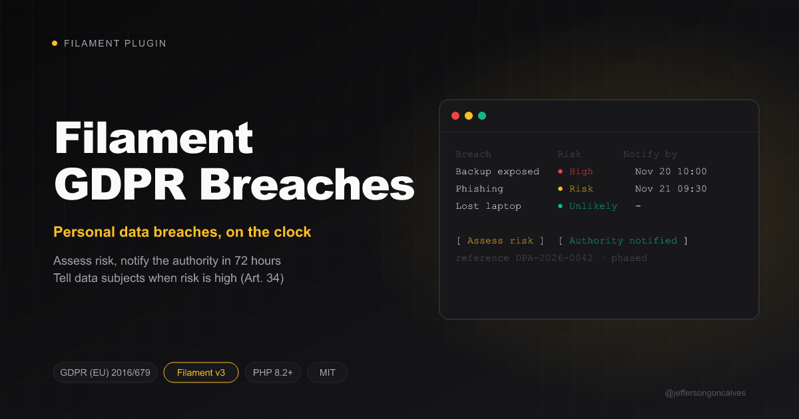

<div class="filament-hidden">



</div>

# Filament GDPR Breaches

[](https://packagist.org/packages/jeffersongoncalves/filament-gdpr-breaches)
[](https://github.com/jeffersongoncalves/filament-gdpr-breaches/actions?query=workflow%3Atests+branch%3A1.x)
[](https://github.com/jeffersongoncalves/filament-gdpr-breaches/actions?query=workflow%3A"Fix+PHP+code+styling"+branch%3A1.x)
[](https://packagist.org/packages/jeffersongoncalves/filament-gdpr-breaches)
[](LICENSE.md)

The Filament panel for [laravel-gdpr-breaches](https://github.com/jeffersongoncalves/laravel-gdpr-breaches): register personal data breaches and keep the 72-hour deadline to notify the supervisory authority in sight (GDPR Arts. 33 and 34).

## Features

- Register a breach: the deadline is 72 hours from when you became aware of it. That date is locked afterwards.
- **Assess risk:** unlikely to result in a risk (documented only), risk (notify the authority) or high risk (also tell the data subjects).
- Record the **authority notification** (with its reference) and the **data subject notification**, then **close** with the measures taken. A notice after 72 hours asks for the reasons for the delay.
- **Notice in phases:** when information is still missing, tick *Notice in phases* and record the rest later with **Further information sent** (Art. 33(4)).
- **No communication needed:** for a high risk that Art. 34(3) exempts (encrypted data, later measures, a public communication), record the reason instead.
- Status badge (open, notification pending, overdue, closed), "Notification pending" and "Overdue" filters, and a navigation badge with pending breaches (red when one is overdue).
- 19 languages.

## Compatibility

| Plugin Version                                                                | Filament |
|-------------------------------------------------------------------------------|----------|
| [1.x](https://github.com/jeffersongoncalves/filament-gdpr-breaches/tree/1.x) | 3.x      |
| [2.x](https://github.com/jeffersongoncalves/filament-gdpr-breaches/tree/2.x) | 4.x      |
| [3.x](https://github.com/jeffersongoncalves/filament-gdpr-breaches/tree/3.x) | 5.x      |

## Installation

You can install the package via composer:

```bash
composer require jeffersongoncalves/filament-gdpr-breaches:"^1.0"
php artisan vendor:publish --tag="gdpr-breaches-migrations"
php artisan migrate
```

Upgrading from an earlier release? Publish and run the migrations again: laravel-gdpr-breaches 1.1 adds the complement columns.

## Usage

```php
use JeffersonGoncalves\Filament\GdprBreaches\GdprBreachesPlugin;

public function panel(Panel $panel): Panel
{
    return $panel
        ->plugins([
            GdprBreachesPlugin::make()
                ->navigationGroup('GDPR')             // default: no group
                ->navigationSort(40)
                ->navigationIcon('heroicon-o-exclamation-triangle')
                ->slug('breaches'),
        ]);
}
```

All fluent methods are optional. The deadline (72 hours) is configured in laravel-gdpr-breaches' `gdpr-breaches` config. Schedule `gdpr:breaches-overdue` to be alerted outside the panel.

> The resource has no authorization of its own: register it only on panels whose users handle breaches, or add a policy for `JeffersonGoncalves\GdprBreaches\Models\Breach`. Records younger than 5 years can't be deleted.

## Testing

```bash
composer test
```

## Changelog

Please see [CHANGELOG](CHANGELOG.md) for more information on what has changed recently.

## Contributing

Please see [CONTRIBUTING](.github/CONTRIBUTING.md) for details.

## Security Vulnerabilities

Please review [our security policy](../../security/policy) on how to report security vulnerabilities.

## Credits

- [Jefferson Gonçalves](https://github.com/jeffersongoncalves)
- [All Contributors](../../contributors)

## License

The MIT License (MIT). Please see [License File](LICENSE.md) for more information.
